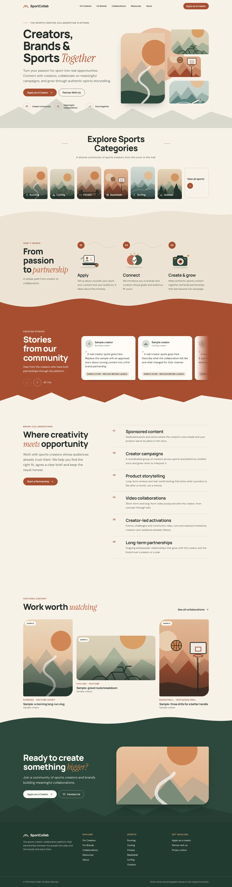

# SportCollab

A responsive collaboration site for sports creators and brands. Warm, editorial, organic design built with Next.js (App Router), TypeScript and Tailwind CSS v4.



More screenshots (desktop, tablet, mobile) are in [`docs/screenshots`](docs/screenshots).

> **Before launch, read [`TODO.md`](TODO.md).** The site ships with clearly marked placeholders: vector stand-ins for photography, sample stories, no partner logos and template legal text. Nothing is fabricated for production visitors: sample content is hidden in production builds unless you opt in.

## Quick start

```bash
npm install
npm run dev          # http://localhost:3000
```

| Script | What it does |
|---|---|
| `npm run dev` | Development server. Form submissions are appended to `.data/submissions.jsonl` when no email provider is configured. |
| `npm run build` / `npm start` | Production build and server. |
| `npm run check` | Type-check, lint and unit tests. |
| `npm test` | Unit tests (Vitest): validation, the submission pipeline, rate limiting, YouTube parsing. |
| `npm run test:e2e` | End-to-end tests (Playwright): navigation, mobile menu, forms, carousel, overflow at nine widths, axe accessibility on every route. Builds and starts its own server. |

## Environment variables

Copy `.env.example` to `.env.local`.

| Variable | Purpose |
|---|---|
| `NEXT_PUBLIC_SITE_URL` | Canonical URLs, sitemap, Open Graph, JSON-LD. |
| `RESEND_API_KEY`, `SUBMISSIONS_TO_EMAIL`, `SUBMISSIONS_FROM_EMAIL` | Email delivery of form submissions via [Resend](https://resend.com). All three are required in production. |
| `NEXT_PUBLIC_SHOW_DEMO_CONTENT` | `true` shows sample stories and sample showcase tiles. Leave unset in production. |
| `ALLOW_LOCAL_SUBMISSION_SINK` | Development/testing only. Writes submissions to a local file instead of email. |

**Without email configuration in production, the forms return a clear "not accepting submissions" error (HTTP 503). They never report success for a submission that went nowhere.**

## Deploying to Vercel

1. Import the repository.
2. Add the environment variables above (Production). Verify your sending domain in Resend.
3. Deploy. For a design review, add `NEXT_PUBLIC_SHOW_DEMO_CONTENT=true` to **Preview** only.

## Where things live

```
src/
  app/                    Routes (home, creators, brands, collaborations, sports/[slug],
                          resources, about, apply, partner, privacy), sitemap, robots, API routes
  components/
    home/                 Homepage sections
    forms/                Creator + brand forms (React Hook Form + Zod)
    media/                Photo slots, scene fallbacks, showcase grid, video modal
    layout/               Header (mobile drawer), footer, logo
    ui/                   Icons, waves/ridges, reveal, parallax, FAQ, page hero
  lib/
    content.ts            Copy and sample content: edit text here
    sports.ts             The eight sport categories
    photos.ts             Photo registry: register real images here
    schemas.ts            Zod schemas shared by browser and server
    server/               Submission pipeline: guards, rate limiting, delivery
  fonts/                  Self-hosted Manrope, DM Sans, Instrument Serif (SIL OFL)
e2e/                      Playwright tests
docs/screenshots/         Mobile, tablet, desktop captures
```

## Replacing content

- **Text:** edit `src/lib/content.ts` (copy), `src/lib/sports.ts` (categories), `src/lib/site.ts` (name, tagline, nav).
- **Brand name:** change `site.name` in `src/lib/site.ts`. It is a placeholder.
- **Stories:** replace the entries in `stories` with real, approved quotes and set `demo: false`.
- **Showcase:** in `showcase`, set `url` to a public YouTube or Instagram link and `demo: false`. YouTube links open in an accessible modal player (youtube-nocookie, loaded only on click). Other links open in a new tab.
- **Partner logos:** add to `partners` in `content.ts` only when the partnership is confirmed and you have permission to use the logo.

### Replacing images

Every photograph position is a named *slot*. Until you register a real photo, the slot renders a vector scene so layouts, crops and colour balance are reviewable.

1. Put the file in `public/photos/` (WebP or AVIF; JPEG is fine, Next.js converts on request).
2. Register it in `src/lib/photos.ts`:

   ```ts
   "hero-portrait": { src: "/photos/hero-portrait.webp", alt: "A trail runner smiling at sunrise", width: 1600, height: 2000 },
   ```
3. Slots: `hero-portrait` (portrait, ~4:5), `hero-cycling`, `hero-basketball`, `hero-surfing`, `closing-group` (wide, ~16:10) and one per sport, `sport-running`, `sport-cycling`, and so on (portrait, ~3:4).

Use properly licensed photography only, with natural light and skin and no AI-generated faces. Set `width`/`height` to the real pixel size so the layout never shifts.

## Design system

Tokens live in `src/app/globals.css` (`@theme`): cream, sand, forest, sage, terracotta, amber, ink. Type is Manrope (headings), DM Sans (body) and Instrument Serif italic (one emphasised word per heading), all self-hosted.

Contrast notes (measured):
- `terracotta` (#B85D3C) is only 4.0:1 on cream, so it is used for large display words only.
- Buttons and the stories panel use `terracotta-deep` (#A64E30, 5.3:1 with paper).
- Small accent text uses `clay` (#8F402A, 6.3:1 on cream, 5.6:1 on sand).
- `muted` text is #5B655D, slightly darker than the design reference, to pass AA on sand.

Shape language: leaf, mirrored leaf, arch, pebble and soft-corner radii (`.shape-*`), plus wave and ridge separators. Motion is limited to a headline fade, image mask entrances, subtle parallax on one background shape, scroll reveals and hover states. Everything respects `prefers-reduced-motion`, and content is visible without JavaScript.

## Form pipeline

`POST /api/apply/creator` and `/api/apply/brand` share one handler (`src/lib/server/apply.ts`):

1. Same-origin check (Origin header must match host).
2. JSON content type, 20 KB body limit.
3. Rate limit, 5 requests per 10 minutes per client.
4. Zod validation, with field-level errors returned to the form.
5. Honeypot (silently dropped) and a minimum-fill-time check (2.5 s).
6. Delivery through Resend, with header-injection-safe subjects and plain-text bodies.

**Known limitation:** the rate limiter keeps counts in process memory. On serverless platforms each instance counts separately, so it only slows casual abuse. For real protection, swap `hit()` in `src/lib/server/rate-limit.ts` for a shared store (Upstash Redis, Vercel KV). The signature is stable.

## Verification status

Measured on a production build (Chromium via Playwright, Lighthouse 12, simulated mobile throttling):

- Unit tests: 58 passing.
- End-to-end tests: 67 passing, including axe (WCAG 2.0/2.1/2.2 A and AA) on 12 routes at desktop and mobile, no horizontal overflow at 360, 375, 390, 430, 768, 1024, 1280, 1440 and 1920 px, keyboard-accessible mobile menu with focus trap, and carousel keyboard/touch behaviour.
- Lighthouse (mobile, home): Performance 96 to 98, Accessibility 100, Best Practices 100, SEO 100. LCP about 2.1 to 2.3 s, CLS 0.

Not covered by automated tests: the YouTube modal (no real video links exist yet; the dialog logic is covered by the platform's native `<dialog>` behaviour and `getYouTubeId` unit tests) and real email delivery (tested against a mocked provider).
